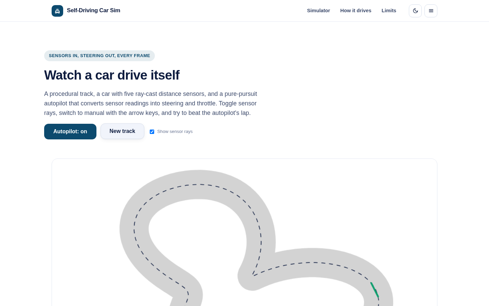
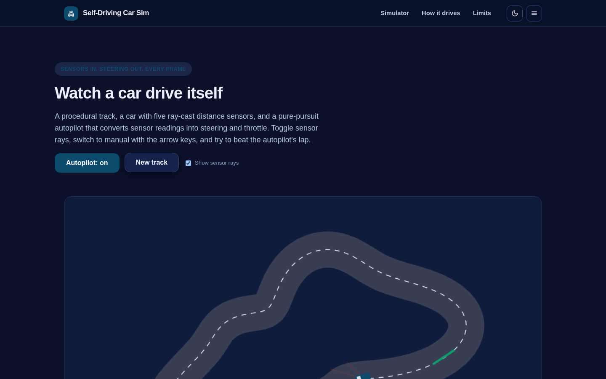
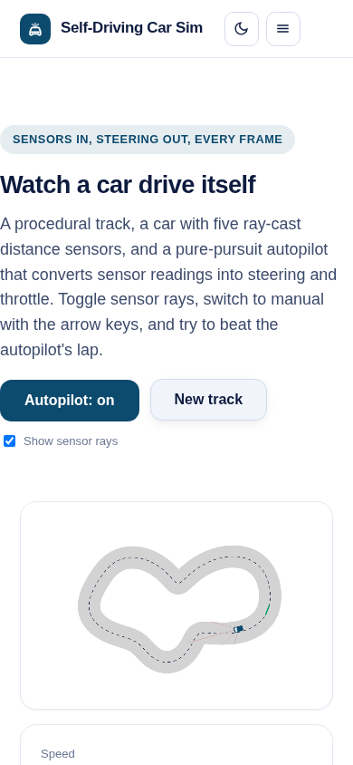

# Self-Driving Car Sim

Watch a car drive itself - sensors in, steering out, every frame.

A procedural 2D track, a car with five ray-cast distance sensors, and a pure-pursuit autopilot converting readings into steering and throttle at 60 fps. Toggle the sensor rays, grab the arrow keys in manual mode, and try to beat the autopilot's lap time.

**Live demo:** https://akash991833.github.io/self-driving-car-sim/



## Features

- Procedural closed-loop tracks (sine-superposition centerlines) - a new track every click
- Five ray-cast distance sensors (-60 to +60 degrees), visualized live
- Pure-pursuit autopilot: lookahead point on the centerline, PID-style steering, clearance- and curvature-aware throttle
- Bicycle-model car physics at 60 fps
- Manual mode with arrow keys, lap timing, best-lap tracking, crash reset
- Dark and light themes, responsive, installable PWA, works offline

## Honest limits

- The autopilot is a deterministic controller, not a learned policy - it follows the centerline with sensor-guided speed control and will not generalize to traffic.
- 2D bicycle model: no tire slip, weight transfer or suspension.
- Manual mode needs a keyboard; on mobile, watch the autopilot.

## Tech

Vanilla JS + Canvas 2D, no build step, zero network calls. Ray marching for sensors, pure-pursuit control, seeded procedural track generation.

## Run locally

```
python3 -m http.server 8073
# open http://localhost:8073
```

## Tests

```
python3 -m http.server 8073 &
node tests/run.mjs
```

40 checks across desktop and mobile, light and dark: sensor ray counts and ranges, autopilot survival over 2100 simulated steps, manual throttle response, canvas rendering, KPIs, track regeneration and console cleanliness.



